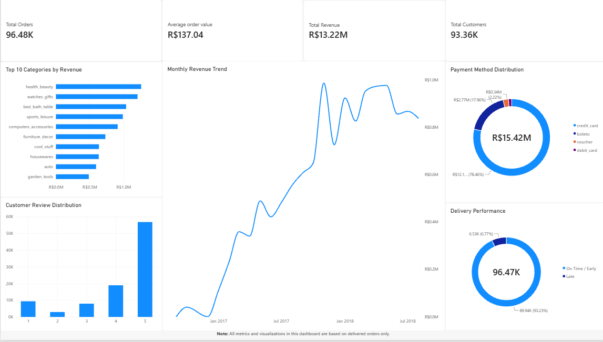

# E-Commerce Intelligence & Revenue Analytics

## Project Overview

This project analyzes the Brazilian E-Commerce Public Dataset by Olist to understand business performance, revenue trends, customer behaviour, product performance, payment methods, delivery performance, and customer reviews.

The project uses Python for data cleaning, exploratory data analysis, and business analysis, MySQL for database management and SQL analysis, and Power BI for interactive dashboard development.

**Note:** All business analysis metrics and dashboard visualizations focus on delivered orders only.

## Tools & Technologies

- Python
- Pandas
- NumPy
- Matplotlib
- Seaborn
- Jupyter Notebook
- MySQL
- Power BI
- Git & GitHub

## Project Structure

```text
ecommerce-intelligence/
│
├── data/
│   ├── raw/
│   └── processed/
│
├── notebooks/
│   ├── 01_data_understanding.ipynb
│   ├── 02_data_cleaning.ipynb
│   ├── 03_exploratory_data_analysis.ipynb
│   ├── 04_data_preprocessing.ipynb
│   └── 05_business_analysis.ipynb
│
├── sql/
│   ├── 01_database_setup.sql
│   ├── 02_table_creation.sql
│   ├── 03_data_import.sql
│   ├── 04_basic_analysis.sql
│   └── 05_intermediate_analysis.sql
│
├── dashboard/
│   └── Olist_Ecommerce_Analytics_Dashboard.pbix
│
├── images/
│   └── dashboard_overview.png
│
├── reports/
│
└── README.md
```

## Project Workflow

### 1. Data Understanding
- Explored the available datasets.
- Examined columns, data types, and dataset structure.
- Identified important business data.

### 2. Data Cleaning
- Handled missing values.
- Checked duplicate records.
- Corrected data types.
- Identified and handled data inconsistencies.

### 3. Exploratory Data Analysis (EDA)
- Explored sales and revenue patterns.
- Analyzed customer and product information.
- Examined payment methods and reviews.
- Explored seller and delivery information.

### 4. Data Preprocessing
- Prepared datasets for analysis.
- Combined relevant datasets.
- Created processed datasets for business analysis.

### 5. Business Analysis
- Analyzed total revenue and order performance.
- Identified top-performing product categories.
- Examined customer purchasing behaviour.
- Analyzed payment methods.
- Evaluated delivery performance.
- Examined customer review ratings.

### 6. SQL Analysis
- Created the MySQL database.
- Created database tables.
- Imported datasets into MySQL.
- Performed basic and intermediate SQL analysis.

### 7. Power BI Dashboard
Developed an interactive dashboard to present key business metrics and visualizations.

## Power BI Dashboard

### Dashboard Preview



### Key Performance Indicators

- Total Revenue
- Total Orders
- Average Order Value
- Total Customers

### Visualizations

- Monthly Revenue Trend
- Top 10 Categories by Revenue
- Payment Method Distribution
- Delivery Performance
- Customer Review Distribution

## Key Findings

The analysis focuses on delivered orders to provide a consistent view of completed sales and business performance.

The project explores revenue trends, product category performance, customer behaviour, payment preferences, delivery performance, and customer satisfaction.

## How to Explore the Project

1. Clone or download this repository.
2. Install the required Python libraries.
3. Open the Jupyter notebooks in the `notebooks` folder.
4. Explore the SQL scripts in the `sql` folder.
5. Open the Power BI dashboard in the `dashboard` folder using Power BI Desktop.

## Author

Harsha K R